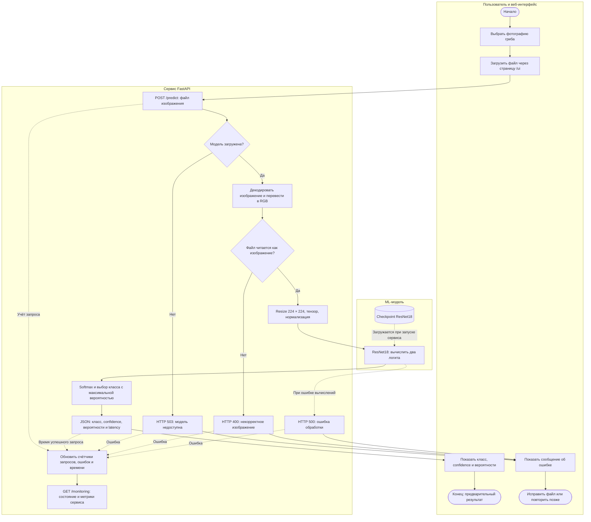
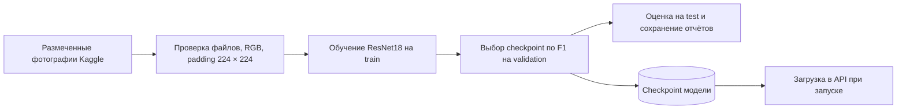

# Место ML-модели в процессе проекта

Схема показывает текущий технический процесс: от загрузки фотографии пользователем до отображения предварительной классификации. Использована блок-схема Mermaid с дорожками участников; это упрощённое представление процесса, а не формальная BPMN 2.0-модель.

## Какую задачу решает модель

ResNet18 преобразует изображение в оценку двух классов: `edible` и `non_edible`. Она занимает место между подготовкой изображения в API и формированием ответа пользователю. Проверка читаемости файла, обработка ошибок, JSON и мониторинг выполняются обычным кодом сервиса.

Модель загружается из checkpoint при старте API. Если веса отсутствуют или не загрузились, сервис может работать, но `/predict` возвращает 503. Некорректное изображение при доступной модели приводит к ответу 400; другие ошибки обработки — к 500. На схеме основной путь показан сплошными стрелками, зависимости и сбор эксплуатационных показателей — пунктирными.

## Почему здесь используется ML

Внешний вид грибов меняется из-за вида, ракурса, освещения и фона. Перечислить все сочетания признаков правилами сложно. Свёрточная сеть обучается извлекать визуальные признаки из размеченных примеров и обобщать их для предварительной классификации. Целесообразность ML здесь относится к учебному прототипу; она не означает, что по одной фотографии можно надёжно установить безопасность гриба.

## Какие данные поступают на вход

Пользователь отправляет один файл изображения через multipart-поле `file`. API переводит его в RGB, изменяет размер до 224 × 224, создаёт тензор `[1, 3, 224, 224]` и нормализует значения каналов. На этапе инференса случайные аугментации не применяются. Отдельной проверки наличия гриба на фотографии нет.

Для обучения используются размеченные фотографии Kaggle: исходные классы `edible` и `poisonous`, причём второй переименован в `non_edible`. Обучение выполняется отдельно от пользовательского запроса:

Текущий split содержит межвыборочные дубликаты, поэтому оценка на test не является независимой проверкой обобщения. Новые пользовательские запросы автоматически не пополняют обучающую выборку и не запускают переобучение.

## Как используется результат

API вычисляет softmax, выбирает класс через argmax и возвращает `predicted_class`, `confidence`, вероятности обоих классов, имя файла, latency и метаданные модели. Страница `/ui` отображает ответ для ознакомления. В текущей реализации нет отдельной ветки отказа при низкой уверенности и нет автоматического направления результата эксперту.

**Результат — предварительная учебная классификация, а не разрешение употреблять гриб в пищу.** Высокий confidence этого не меняет. На сохранённом test модель ошибочно отнесла 22 из 132 примеров `non_edible` к `edible`; подробности и ограничения приведены в [Model Card](model_card.md).

Мониторинг используется для наблюдения за доступностью модели, количеством запросов и ошибок, средней задержкой и ресурсами сервера. Публикуемые там accuracy, precision, recall, F1 и ROC-AUC читаются из сохранённого отчёта: они не пересчитываются по новым фотографиям, для которых сервис не получает истинные метки.

## Связь с реализацией

- [API и интерфейс](src/api/app.py): загрузка модели, `/predict`, `/ui`, `/monitoring`.
- [Обучение и преобразования](src/training/train_baseline.py): ResNet18, нормализация, оценка и сохранение checkpoint.
- [Подготовка датасета](src/data/prepare_dataset.py): проверка изображений, padding и манифесты.
- [Отчёт baseline](reports/baseline/best_baseline.json): конфигурация и метрики описанной модели.
