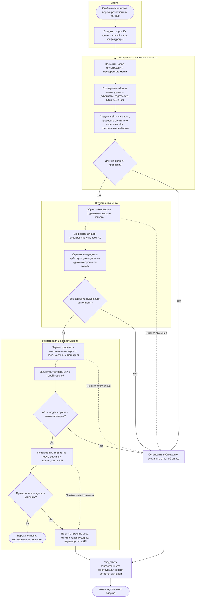

# Процесс автоматического переобучения модели

Документ описывает **проектируемый процесс автоматизации** для Mushroom Edibility Classifier: от поступления новой версии данных до развёртывания проверенной ResNet18. В репозитории уже есть подготовка данных, обучение, оценка, сохранение checkpoint и API в Docker. Автоматические триггеры переобучения, контроль публикации, реестр версий и автоматический деплой пока не реализованы. Добавление этой схемы само по себе их не запускает.

Использована Mermaid-блок-схема с дорожками этапов — упрощённое представление процесса, а не формальная BPMN 2.0-модель.

## Схема



Сплошные стрелки показывают основной ход и решения, пунктирные — отдельные аварийные переходы. Ошибка получения данных, подготовки или оценки также останавливает запуск до публикации.

## Этапы и передаваемые результаты

| Этап | Что происходит | Результат для следующего шага |
| --- | --- | --- |
| 1. Триггер | Публикация новой версии датасета с проверенной разметкой создаёт событие запуска. Оркестратор проверяет, что эта версия данных и конфигурации ещё не обработана, и исключает параллельные публикации | ID запуска, версия данных, commit кода, параметры обучения и ссылка на действующую модель |
| 2. Получение данных | Загружаются разрешённые к использованию фотографии и метки `edible`/`non_edible`; исходный `poisonous` нормализуется в `non_edible`. Новые загрузки пользователей без истинных меток не считаются обучающими данными | Зафиксированный снимок исходных данных с происхождением, метками и контрольными суммами |
| 3. Подготовка и проверка | Проверяются читаемость, допустимые классы, наличие обоих классов и распределение данных. Выполняются RGB, padding до 224 × 224 и манифесты. Точные дубликаты удаляются, связанные изображения группируются перед разбиением. Проверяются пересечения с контрольным набором | Версионированные train/validation, отдельный контрольный набор и отчёт качества данных; при нарушениях — отказ |
| 4. Обучение | В изолированном каталоге запуска обучается ResNet18. Используются аугментации train, взвешенная CrossEntropyLoss, AdamW, scheduler и early stopping. Лучший checkpoint выбирается по F1 `non_edible` на validation | Checkpoint кандидата, конфигурация, история обучения и validation-метрики |
| 5. Проверка качества | Кандидат и действующая модель оцениваются на одном независимом размеченном контрольном наборе без аугментаций. Рассчитываются accuracy, precision, recall, F1 `non_edible`, ROC-AUC и матрица ошибок; проверяются загрузка весов и корректность выходов | Сравнительный отчёт, результаты технических проверок и число опасных ошибок `non_edible → edible` |
| 6. Решение о публикации | Автоматический шлюз применяет заранее утверждённые критерии ниже. Ошибка проверки или отсутствие обязательной метрики трактуются как отказ | Решение «допустить/отклонить» с причинами; отклонённый кандидат не заменяет действующую модель |
| 7. Регистрация | Допущенный кандидат сохраняется в неизменяемое хранилище артефактов под уникальным ID. Фиксируются хеш весов, данные, код, параметры, метрики, Model Card и решение шлюза | Версия модели со статусом «готова к деплою» и воспроизводимый манифест; действующая версия ещё не меняется |
| 8. Тестовое развёртывание | Отдельный контейнер API получает веса и соответствующий отчёт. Проверяются загрузка модели, `/monitoring`, `/predict` на контрольных файлах, схема ответа и ошибочные запросы | Проверенный комплект: версия модели, отчёт, конфигурация и версия образа |
| 9. Деплой | Сохраняется ссылка на прежний комплект; сервис переключается на новый и перезапускается. После переключения выполняются проверки доступности, состояния модели и пробного предсказания | Активная версия и запись о деплое либо команда отката |
| 10. Наблюдение или отказ | После успеха наблюдаются ошибки, latency и ресурсы. До переключения любой отказ сохраняет прежнюю версию. После неудачного переключения возвращается прежний комплект, проверяется восстановление и отправляется уведомление | Журнал результата, диагностические отчёты и рабочая версия; повторный запуск после устранения причины |

## Критерии допуска к публикации

Предлагаемая политика должна быть сохранена в конфигурации до оценки кандидата:

- Проверки данных и технические проверки прошли, выходы конечны, вероятности корректны, порядок классов совпадает с `['edible', 'non_edible']`.
- Recall `non_edible` достигает заранее утверждённого `min_recall_non_edible` и не ниже recall действующей модели на том же контрольном наборе. Эта метрика отражает риск пропустить опасный по разметке гриб.
- F1 `non_edible` не ниже F1 действующей модели. Проверяются также согласованные ограничения на latency и потребление памяти в одинаковом окружении.
- Все обязательные пороги заданы и все проверки выполнены. При отсутствии утверждённого порога публикация блокируется; универсальный безопасный порог из текущего отчёта не выводится.

Значения существующего baseline (test recall 0.8333, F1 0.8835) — исторические результаты, а не пороги публикации. В исходном split есть межвыборочные дубликаты, поэтому сначала требуется независимый контрольный набор и повторная оценка действующей модели. Сам контрольный набор нельзя использовать для выбора эпох и подбора параметров; частое сравнение версий требует периодического обновления независимой оценки.

Если действующей версии ещё нет, применяется отдельно утверждённая политика первого выпуска с абсолютными порогами; отсутствие модели не означает автоматическое разрешение публикации.

## Как процесс связан с текущим проектом

- [prepare_dataset.py](src/data/prepare_dataset.py) выполняет подготовку изображений и создаёт манифесты. Автоматическое исключение межвыборочных дубликатов, формирование нового разбиения по группам и шлюз качества данных необходимо добавить.
- [train_baseline.py](src/training/train_baseline.py) обучает и оценивает модель, сохраняет веса, `metrics.json`, историю и графики. Для изоляции запусков предусмотрены параметры `--data-dir`, `--model-dir`, `--report-dir`; автоматическую версионизацию и сравнение кандидата с действующей моделью необходимо добавить.
- [API](src/api/app.py) загружает checkpoint при запуске через `MODEL_PATH`; отчёт для мониторинга задаётся через `METRICS_PATH`. Для новой версии нужно передавать совместимый отчёт с метриками именно этих весов. Переименование или замена файла без перезапуска не обновляет модель в памяти.
- [docker-compose.yml](docker-compose.yml) уже подключает каталоги моделей и отчётов к сервису. Проектируемый деплой должен выбирать конкретные версии обоих артефактов и сохранять предыдущую конфигурацию для отката; автоматического переключения сейчас нет.
- [GitHub Actions CI](.github/workflows/ci.yml) проверяет код, тесты и Docker-сборку. Это основа технических проверок, но текущий workflow не выполняет описанное автоматическое переобучение и публикацию.

Пример структуры внешнего хранилища артефактов (предлагается, пока не создаётся кодом):

```text
model-registry/
└── <version-id>/
    ├── baseline_resnet18.pt
    ├── metrics.json
    ├── manifest.json
    ├── quality_gate.json
    └── model_card.md
```

Мониторинг `/monitoring` сейчас показывает эксплуатационные показатели и сохранённые test-метрики. Он не вычисляет качество на новых запросах без истинной разметки. Триггер по падению качества можно добавить только после организации сбора проверенных меток и отдельного расчёта метрик; в этой схеме основной триггер — новая версия размеченного датасета.

Даже после успешного переобучения назначение модели остаётся учебным: предсказание не подтверждает безопасность употребления гриба. Подробнее: [Model Card](model_card.md) и [процесс применения модели](Model_BPMN.md).