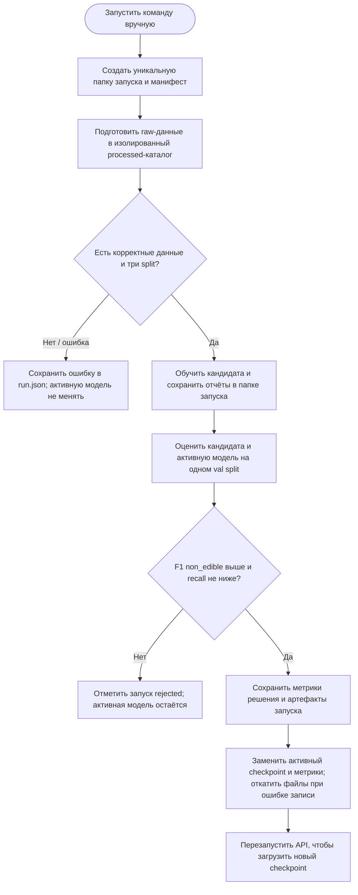

# Переобучение модели

Этот документ описывает реализованный локальный сценарий переобучения. Он
заменяет исходный проектный вариант диаграммы из
[Model_retrain_BPMN.md](Model_retrain_BPMN.md), который предполагал отсутствующие
в проекте реестр моделей, автоматическую доставку данных и деплой.

Команда `src/training/retrain.py` запускает подготовку исходных изображений,
обучение кандидата в отдельной папке, сравнение с активной моделью и условную
публикацию. Для сравнения используется один и тот же `val` split, чтобы решение
не зависело от метрик модели, посчитанных на разных наборах. `test` остаётся
контрольным набором и не используется в правиле публикации.

## Реализованный процесс



При первом запуске активной модели может ещё не быть: тогда кандидат становится
первой активной версией, если проверки данных и обучения завершились успешно.
Артефакты запуска остаются в `runs/retraining/<run_id>/`, включая обработанные
данные, checkpoint кандидата, историю обучения, графики, метрики и решение.

## Перед запуском

Ожидается исходная структура каталогов, которую использует
[`src/data/prepare_dataset.py`](src/data/prepare_dataset.py):

```text
data/raw/splitted_dataset/
├── train/{edible,poisonous}/
├── val/{edible,poisonous}/
└── test/{edible,poisonous}/
```

Метки должны быть проверены человеком. Подготовка переводит `poisonous` в
`non_edible`, проверяет открытие изображений и строит манифест с SHA-256.
Дубликаты попадают в отчёт, но автоматически не удаляются; проверка пересечения
дубликатов между split не блокирует запуск. Сохраняйте отдельный контрольный
набор и не меняйте его между сравнениями моделей.

## Запуск

Из корня репозитория:

```powershell
poetry run python src\training\retrain.py
```

Скрипт берёт данные из `data/raw/splitted_dataset`, обрабатывает их в папке
конкретного запуска и обучает ResNet18 с настройками baseline. Если кандидат
принят, он копируется в `models/baseline_resnet18.pt`, а его метрики — в
`reports/baseline/best_baseline.json`, откуда `/monitoring` по умолчанию читает
метрики. API загружает checkpoint при старте, поэтому после
успешной публикации перезапустите API или контейнер:

```powershell
docker compose restart api
```

Между публикацией и перезапуском уже работающий API ещё использует старые
загруженные веса, а `/monitoring` может прочитать обновлённые метрики с диска.
Перезапустите сервис сразу после успешного запуска retrain, чтобы модель и
показываемые метрики соответствовали друг другу.

Если API запущен напрямую, остановите и повторно выполните команду uvicorn из
README. Для просмотра причины отказа откройте `run.json` и
`reports/promotion_evaluation.json` в каталоге запуска.

Пример с ограниченным числом эпох:

```powershell
poetry run python src\training\retrain.py --epochs 5 --batch-size 16
```

Путь к новому источнику данных и правило допуска можно задать явно:

```powershell
poetry run python src\training\retrain.py `
  --raw-dir D:\datasets\mushrooms\splitted_dataset `
  --min-f1-improvement 0.01 `
  --max-recall-drop 0.00
```

`--min-f1-improvement` задаёт минимальный прирост validation F1 относительно
активной модели. При значении `0` F1 всё равно должен строго вырасти.
`--max-recall-drop` задаёт максимально допустимое снижение validation recall
класса `non_edible`; по умолчанию снижение запрещено. При отклонении команда
завершается кодом `2` и не меняет активную модель. Ошибки подготовки или
обучения сохраняются в `run.json`, команда завершается с ошибкой.

Можно выбрать другую поддерживаемую архитектуру или ImageNet-веса:

```powershell
poetry run python src\training\retrain.py --model-name mobilenet_v3_small --pretrained
```

При загрузке API определяет архитектуру из checkpoint. Для `--pretrained`
torchvision должен иметь доступ к весам ImageNet или уже иметь их в кеше.

## Что проверяется и что пока вручную

- Подготовка проверяет наличие ожидаемых каталогов, читаемость изображений и
  наличие валидных записей; создаёт три split, нормализованные классы и манифест.
- После обучения checkpoint кандидата и активная модель оцениваются на одном
  `val` split. Условия публикации: F1 кандидата строго больше F1 активной модели
  плюс заданный порог, recall `non_edible` не ниже допустимой границы.
- При принятии checkpoint и сводка метрик для API (`best_baseline.json`) каждый
  заменяется через временный файл с `os.replace`; при ошибке записи код
  восстанавливает прежние файлы. Отчёт тренировки `metrics.json` и остальные
  артефакты сохраняются отдельно в каталоге запуска.
- Источник данных должен заранее содержать train/val/test и размеченные классы.
  Скрипт не скачивает новые данные, не создаёт новый split, не удаляет
  дубликаты и не отправляет уведомления.
- Публикация локально обновляет файлы, но не перезапускает API. После рестарта
  проверьте `GET /monitoring`: поле `model.loaded` должно быть `true`.
- Автоматический триггер по новой версии данных, тестовый API, проверка
  работающего сервиса и автоматический rollback после неудачного health check
  требуют отдельной инфраструктурной интеграции и здесь не реализованы.

Старая диаграмма [`Model_retrain_BPMN.md`](Model_retrain_BPMN.md) сохраняет
исходный замысел автоматизированного production-процесса; для команд и поведения
текущей реализации руководствуйтесь этим файлом.
